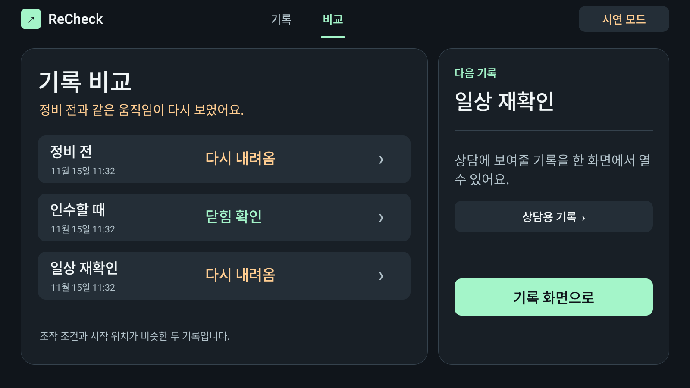

# 같은 증상, 다시 확인

운전석 창문이 가끔 닫히다 다시 내려옵니다. 그런데 정비소에 가면 잘 닫힙니다. 며칠 뒤 같은 일이 생겼을 때, 어떻게 움직였는지 또 처음부터 설명해야 합니다.

ReCheck는 주차한 차에서 운전석 창문의 위치를 읽고, **정비 전 → 인수할 때 → 일상 재확인**을 한 건으로 이어서 보여주는 Pleos Connect 앱입니다. 다음에 정비사와 이야기할 때 이전 기록부터 바로 꺼낼 수 있습니다.

[시연 영상](https://github.com/sanghoon21/pleos-recheck/releases/download/v0.3.0/same-symptom_demo_v3.mp4) · [APK와 소스](https://github.com/sanghoon21/pleos-recheck/releases/tag/v0.3.0) · [SDK 연동 검증 영상](https://github.com/sanghoon21/pleos-recheck/releases/download/v0.3.0/same-symptom_pleos-sdk-verification_v0.3.0.mp4)



*제출 APK에서 모의 위치값으로 기록한 예입니다.*

## 차에서 쓰는 순서

1. 주차한 차에서 창문 기록을 시작하고 순정 스위치를 평소처럼 조작합니다.
2. 기록을 마치면 ‘다시 내려옴’이나 ‘닫힘 확인’처럼 이번에 확인한 결과를 볼 수 있습니다. 위치값의 흐름은 ‘움직임 자세히’에서 확인합니다.
3. 차를 인수할 때와 이후에도 같은 증상 건에 기록을 남깁니다. 다시 상담할 일이 생기면 정비 전부터 이어진 기록을 텍스트로 내보낼 수 있습니다.

기록은 차주가 직접 시작합니다. 관찰을 시작할 때의 위치나 조작 조건이 다르면 비교를 보류합니다. 앱은 관찰한 움직임을 보여주며 원인과 정비 결과의 판단은 차주와 정비사가 함께 합니다.

## 바로 실행하기

릴리스에서 `SSH_ReCheck_release.apk`를 받거나 소스의 [`apk/`](apk/) 폴더에서 `SSH_같은증상다시확인_release.apk`를 받습니다. Android SDK Platform Tools가 있는 PC에서 검토용 에뮬레이터에 설치합니다.

```powershell
adb devices
adb -s <기기번호> install -r SSH_ReCheck_release.apk
adb -s <기기번호> shell am start -n io.recheck.app/.MainActivity
```

일반 Android 에뮬레이터에서 모의 데이터로 시작합니다. 정비 전·인수 때·일상 재확인 기록을 차례로 저장한 뒤 기록 화면과 공유 선택창을 열 수 있습니다. Pleos에서는 앱의 데이터 출처를 차량 읽기로 바꾸고, 읽기 권한과 P·정지 상태를 확인한 뒤 닫힌 위치를 등록합니다. 자세한 절차는 [검증 기록](docs/VALIDATION.md)에 있습니다.

## 검증 환경

| 실행 환경 | 버전과 화면 | 확인 내용 |
|---|---|---|
| 일반 Android 에뮬레이터 | Android 15 / API 35, 1600×900 | 세 시점 기록·비교·상담용 텍스트 공유 선택창과 앱 재실행 후 복원을 확인했습니다. |
| 공식 Pleos Connect 에뮬레이터 | 2.1.0 / API 34, 2560×1440, Vehicle SDK 2.3.2 | 운전석 창문 현재 위치 조회, 가상 차량 신호로 세 관찰의 신규 저장·비교와 앱 재실행 후 복원을 확인했습니다. |

SDK 시험에는 Virtual Console의 가상 차량 신호를 사용했습니다. 실제 차량에서의 신호 지원과 정비 과정에서의 시간·비용 절감은 후속 검증 항목입니다. 기록은 기기에 저장되며 모의 데이터와 SDK 수신 데이터는 별도 파일에 보관합니다. 사용자가 공유 앱을 고르면 해당 앱에 텍스트 파일을 전달합니다.

[개발 환경과 빌드](docs/DEVELOPMENT.md) · [검증 절차와 근거](docs/VALIDATION.md)
